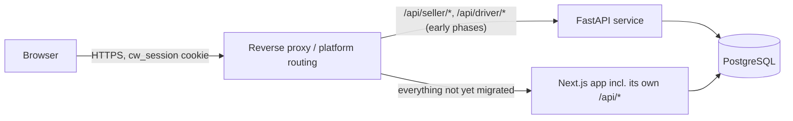

# API_CONTRACT_MIGRATION_MATRIX.md

Phase 02 — Deliverable 6 of 10. The exact, field-by-field wire contract for every route (request schema, response DTO shape, every distinct error code) was extracted this phase by direct reading of every Zod schema and DTO type definition in the repository — see the companion extraction retained in this phase's working notes; the full per-field detail for each route is reproduced below, organized for migration planning rather than as a second, disconnected reference. All entries are **VERIFIED** (read from the exact schema/type/`ApiError` call site) unless marked otherwise.

## 1. Coexistence and routing strategy (applies to every route below)

**Recommended approach: same-origin reverse proxy, path-based routing, one route migrated at a time.**

- The public API path (`/api/...`) **does not change for any migrated route** — the frontend's existing `apiFetch()` calls (`src/lib/api/client.ts`) keep calling the exact same path; only which process answers that path changes, via proxy configuration, not frontend code (except for the Server-Component-direct-access cases in Deliverable 2 §1, which need their own code change regardless of proxying).
- Migration granularity is **per-route, not per-domain-all-at-once** where that's safe — e.g., `GET /api/categories` (public, read-only, zero state) can move to FastAPI independently of `POST /api/orders` (the highest-risk route in the system) moving much later.
- Every response envelope, every error code, every status code is preserved **exactly** (§2 below) — this is what makes "the frontend does not need to be rewritten" achievable; a byte-for-byte-compatible FastAPI response is indistinguishable to the existing `apiFetch`/`ApiClientError` client code (`src/lib/api/client.ts`) from the current Next.js response.

## 2. Global conventions every FastAPI route must replicate exactly

- **Success**: same JSON shape Next.js returns today (see per-route table, §4) — note several routes return the payload **unwrapped** at the top level (e.g. `GET /api/products` returns `{products, pagination}` directly, not nested under a `data` key) vs. others nest under a named key (e.g. `{order: OrderDto}`) — **this inconsistency already exists in the current API and must be preserved exactly per-route, not normalized**, since normalizing it would itself be a breaking change to the frontend.
- **Error envelope**: `{error: {code: string, message: string, field?: string}}`. FastAPI equivalent: a custom `ApiError` exception class + a registered `@app.exception_handler(ApiError)` that serializes to this exact shape, **not** FastAPI's default `{"detail": "..."}` validation-error shape (which must be overridden via a custom `RequestValidationError` handler mapping Pydantic's error format into `{error:{code:"validation_error", message, field}}` to match Zod's current error shape).
- **Status codes**: 400 (bad JSON/validation), 401 (unauthenticated), 403 (forbidden/role mismatch/missing profile), 404 (not found/foreign resource), 409 (conflict/invalid transition/already exists), 422 (semantically invalid — e.g. below minimum order qty, COD cap exceeded), 429 (OTP lockout), 500 (unexpected) — **all must be replicated per-route exactly as cataloged in §4**, since the frontend's error-handling code branches on these specific codes in places (e.g. seller-portal forms distinguish 401 vs 403 messaging, per Phase 01's frontend audit).
- **CSRF**: `assertSameOrigin()` logic (reject cross-site, validate Origin against own-origin/`APP_ORIGIN`/`x-forwarded-host`) must be ported to FastAPI as middleware/dependency applied to every non-GET route, reusing the same allow-list logic — not a new security model (Authentication Migration Plan §1,§4).
- **Auth dependency injection**: every route's auth requirement (none / `requireCustomer` / `requireSeller` / `requireDriver` / `requireAdmin`) is preserved exactly — see the per-route table.

## 3. Breaking changes identified: **none required**

This phase found **zero cases** where faithfully preserving the existing contract is impractical in FastAPI/Pydantic — every existing Zod constraint (regex, min/max, enum, `.strict()`/`extra="forbid"`, conditional `superRefine`-style cross-field validation) has a direct Pydantic v2 equivalent. **The one deliberate, flagged exception** is the Decimal-summation display precision issue (Database/ORM Migration Plan §6) — fixing that changes *internal computation*, not the wire contract (the response field is still a decimal-string at the same precision), so it is not a breaking change to the frontend, only an internal quality improvement.

## 4. Per-route migration table

Legend: **Phase** references the suggested Migration Roadmap tranche (Deliverable 9) — **T1** (low-risk, read-only/public), **T2** (customer write paths), **T3** (seller/driver write paths), **T4** (checkout/orders — highest risk, migrated last), **T5** (net-new, no existing equivalent).

### Auth
| Route | Auth | Phase | Notes |
|---|---|---|---|
| `POST /api/auth/login` | none | T2 | Sets `cw_session` cookie — see Auth Migration Plan for the exact bcrypt/session-table replication requirement |
| `POST /api/auth/logout` | none (own cookie) | T2 | Deletes the DB session row, then clears cookie |
| `GET /api/auth/me` | `requireUser` | T1 | Read-only, safe early candidate once auth dependency chain is proven (Auth Migration Plan §5 acceptance test) |
| `POST /api/auth/register` | none | T2 | Hardcodes `role:"customer"` server-side — replicate this exactly, never derive role from client input |

### Addresses
| Route | Auth | Phase | Notes |
|---|---|---|---|
| `GET /api/addresses` | `requireCustomer` | T2 | |
| `POST /api/addresses` | `requireCustomer` | T2 | Default-address invariant logic (un-default siblings) must be replicated in the same transaction |
| `PATCH/DELETE /api/addresses/[id]` | `requireCustomer` | T2 | |

### Catalog (public, no auth)
| Route | Phase | Notes |
|---|---|---|
| `GET /api/categories` | **T1** | Zero state, safest first FastAPI route to ship — recommended literal first migration target |
| `GET /api/products` | **T1** | Pagination/sort/filter logic must be replicated exactly (query schema in §2 of the extraction) |
| `GET /api/products/[id]` | **T1** | Lookup-by-id-OR-code behavior must be preserved |
| `GET /api/products/[id]/offers` | **T1** | Returns `offers` duplicated at both top level and nested in `product.offers` — preserve this redundancy exactly, do not "clean it up," since it may be relied upon by the frontend either way |
| *(indirect: `/`, `/search`, `/product/[id]` Server Components)* | **T1, but requires a frontend code change** | These pages currently bypass all 4 routes above via direct Prisma access (Dependency Inventory §1a) — migrating this domain's *data* to FastAPI requires first converting these 6 files to `fetch()` the routes above, a prerequisite step, not a side effect |

### Cart
| Route | Auth | Phase |
|---|---|---|
| `GET /api/cart` | `requireCustomer` | T2 |
| `POST /api/cart/items` | `requireCustomer` | T2 |
| `PATCH/DELETE /api/cart/items/[itemId]` | `requireCustomer` | T2 |
| `POST/DELETE /api/cart/coupon` | `requireCustomer` | T2 |

All four cart routes share one real transactional/locking requirement (`lockOffer`, Database Migration Plan §4) — migrate together as one unit, not independently, since they share the same concurrency-correctness surface.

### Checkout & Orders — **highest risk, migrate last (T4)**
| Route | Auth | Notes |
|---|---|---|
| `POST /api/checkout/preview` | `requireCustomer` | Never errors on an unserviceable cart — populates `errors[]`/`canPlaceOrder:false` instead; this non-error-on-business-invalidity pattern must be preserved exactly, not "fixed" into a 422 |
| `POST /api/orders` | `requireCustomer` | The single highest-stakes route in the system — idempotency key construction (Database Migration Plan §7), sorted-lock order (§4), conditional stock decrement (§3), all three must be bit-for-bit equivalent before this route moves |
| `GET /api/orders` | `requireCustomer` | `includeOtp` always `false` here — the OTP-never-in-list-view behavior is a real security property (prevents OTP leakage via a bulk list endpoint), replicate exactly |
| `GET /api/orders/[id]` | `requireCustomer` | `includeOtp` always `true` here, OTP only non-null when `status==="dispatched"` — the one place OTP is ever returned to a customer |
| `POST /api/orders/[id]/cancel` | `requireCustomer` | Cancellable-status guard + stock restore + escrow refund, inside a lock — see Database Migration Plan §3 |

### Driver — T3
All 5 routes (`jobs`, `jobs/[id]`, `jobs/[id]/accept`, `/deliver`, `/issue`) share `requireDriver` and the OTP-verification/lockout mechanism — migrate as one unit. `deliver`'s error table (otp_missing/otp_locked/otp_invalid with try-count-aware messages, 429 lockout) is the most error-code-dense route in the system — a strong candidate for an explicit contract test (request each error condition against both backends, diff the JSON) before cutover.

### Seller — T3
Orders (`orders*`, `accept/pack/reject/dispatch`) share the transaction/lock requirements already detailed; Settings/Delivery/Payments/Performance/Products are lower-risk reads/simple-writes and can move slightly ahead of the order-lifecycle routes within T3 if desired, since they don't touch stock/escrow (except Products' stock endpoints, which should move together with — or after — the order-lifecycle routes given the lost-update risk flagged in Database Migration Plan §5).

### Health
`GET /api/health` — no auth, bypasses the global error envelope entirely (its own `{status,service,database}` shape, VERIFIED `src/app/api/health/route.ts:10-32`). **Recommend giving FastAPI its own, separate health endpoint rather than trying to proxy this one** — a health check should always answer from the process actually being checked, not be routed through the other service.

### Net-new (T5, no existing Next.js equivalent to migrate — build directly in FastAPI)
Admin (all of it), Notifications (delivery mechanism), File uploads/KYC — these have no "migration" risk because there is nothing to preserve; see Business Workflow Migration Plan §12-14.

## 5. Same-origin reverse proxy mechanics (Next.js side)

Next.js's own `rewrites()` config (`next.config.ts`) can route specific `/api/*` paths to the FastAPI service's internal address while leaving everything else served by Next.js's own route handlers — this is the simplest, lowest-infrastructure-change way to achieve the proxy in the coexistence diagram above, requiring no separate reverse-proxy software for most of the migration window (a platform-level proxy/load-balancer becomes relevant mainly at final cutover or if Next.js's own rewrite proxying proves insufficient under load — evaluated further in the Deployment Plan).
