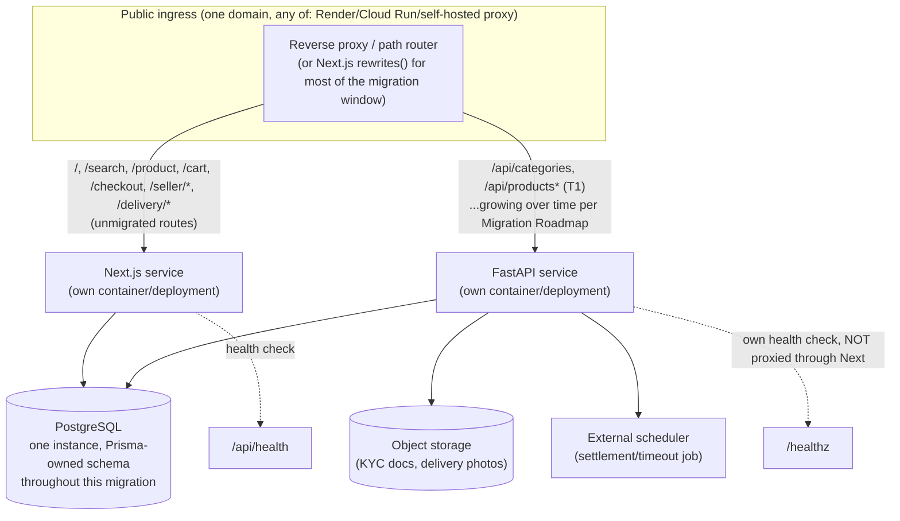

# DEPLOYMENT_AND_INFRASTRUCTURE_PLAN.md

Phase 02 — Deliverable 8 of 10. Per instruction: "Do not silently choose one" among Render/Docker/GCP — this document presents the conflict explicitly (carried forward from Phase 01, re-confirmed unchanged this phase) and recommends an explicit decision process, while providing an infrastructure design that works under any of the three.

## 1. The conflict, re-confirmed unchanged

Three deployment stories coexist in this repository, unresolved since Phase 01:
1. `DECISIONS.md` D10 (approved 2026-11-05): Docker-based deployment.
2. `render.yaml` (repo root, re-confirmed present and current this phase): the **actually-deployed** target, Render.com free tier.
3. This engagement's own brief: Google Cloud (Cloud Run/Cloud SQL/Cloud Storage/Secret Manager).

**This document does not resolve the conflict** (Phase 01 already correctly declined to, and nothing has changed to make that decision this phase's to make unilaterally) — it is listed again in `RISKS_DECISIONS_AND_OPEN_QUESTIONS.md` as still requiring explicit sign-off. What follows is designed to be **valid under any of the three**, with GCP-specific detail where the brief asks for it, exactly as Phase 01 did.

## 2. Target: independently deployable Next.js + FastAPI, one shared PostgreSQL

- **Two independently deployable artifacts**: the existing `app/Dockerfile` (Next.js, `output:"standalone"`, already proven to build — Phase 01) continues to be the Next.js deployment unit unchanged; a **new** `fastapi/Dockerfile` (or equivalent for the chosen platform) is the FastAPI deployment unit. Neither depends on the other's build process; they can be deployed on independent schedules, satisfying this phase's "independently deployable" requirement directly.
- **One shared PostgreSQL instance** throughout — no new database is provisioned for FastAPI; it connects to the exact same `DATABASE_URL` target Next.js already uses (same host, same credentials-management approach, whichever platform is chosen).

## 3. Same-origin reverse proxy vs. alternatives (evaluated per instruction)

- **Recommended: same-origin, path-based routing**, via (in order of preference, platform-dependent): (a) Next.js's own `rewrites()` config in `next.config.ts` pointing specific `/api/*` sub-paths at the FastAPI service's internal/private address — zero additional infrastructure, works identically in dev/preview/prod, and is the lowest-effort way to get started; (b) a platform-level path router (e.g. Cloud Run's own URL-map/load-balancer path rules, or Render's equivalent) once the number of migrated routes makes per-route `rewrites()` entries unwieldy. **This keeps the browser talking to exactly one origin for the entire migration**, which (per the Authentication Migration Plan §4) means **no CORS configuration is ever needed**, and the `cw_session` cookie (no explicit `domain` attribute, Phase 01/this-phase finding) is automatically sent to both services without any change.
- **Alternative evaluated, not recommended: separate subdomain** (e.g. `api.constrowell.com` for FastAPI). Works, but introduces real CORS configuration and cookie-domain-sharing requirements (Authentication Migration Plan §4) for no functional benefit during an internal migration — only worth it if there's an external reason (e.g. a genuinely separate team/release cadence needing full infrastructure independence, or the future mobile client, which per Phase 01 would use token auth, not cookies, and thus doesn't need same-origin at all). **Recommendation: keep same-origin for the human-facing web app throughout this migration; treat a future mobile-API subdomain as a separate, later, additive decision, not a reason to split the web app's origin today.**

## 4. Environment variables (current + new)

Existing (re-confirmed from `app/.env.example` this phase, unchanged): `DATABASE_URL`, `SESSION_SECRET` (**note**: its own comment says "Not read by app code yet" — confirmed still true; this is a stale/aspirational env var with no current effect, flagged here so it isn't assumed load-bearing by whoever configures the FastAPI service's environment), `DEMO_PASSWORD`, `OTP_ENCRYPTION_KEY`, `APP_ORIGIN`, `NODE_ENV`.

New, for the FastAPI service: `DATABASE_URL` (**same value**, shared database), `OTP_ENCRYPTION_KEY` (**same value** — required for cross-implementation AES-GCM compatibility, Business Workflow Migration Plan §9), `APP_ORIGIN` (same same-origin check logic), plus FastAPI-specific: `SENTRY_DSN` (new observability integration, Phase 01's recommendation), `OBJECT_STORAGE_BUCKET`/credentials (once File Uploads, workflow 14, is built), `INTERNAL_SETTLEMENT_SECRET` (a shared-secret header for the scheduled settlement job's internal endpoint, not a user session — Phase 01's `WP-P0-1`).

**Secret-sharing mechanism between the two services**: whichever secret-management approach is chosen (platform env vars today; Secret Manager if GCP is confirmed) must provide the **identical** `OTP_ENCRYPTION_KEY` and session-related values to both services — a mismatch here would silently break OTP decryption or session validation for whichever requests land on the "wrong" (differently-configured) service, a subtle and dangerous class of bug to introduce via a deployment-config mistake rather than a code bug. **Recommend a single secrets source feeding both deployments' environment, never two independently-maintained copies of the same secret value.**

## 5. CI/CD for two services

Building on Phase 01's confirmed-broken CI finding (the one workflow file is in a location GitHub Actions never discovers): the target CI setup needs **two independent build/test/deploy pipelines** (one per service, triggered by changes to their respective directories) **plus one integration-level pipeline** that stands up both services (and a disposable test Postgres) together and runs the cross-backend contract tests this plan has repeatedly called for (session-portability, OTP cross-compatibility, idempotency-hash equivalence). Recommend: `.github/workflows/nextjs-ci.yml`, `.github/workflows/fastapi-ci.yml`, `.github/workflows/integration-ci.yml`, all at the **correct** repository root location (directly fixing Phase 01's confirmed defect, not perpetuating it into the new FastAPI codebase as well).

## 6. GCP-specific evaluation (per brief, if GCP is the eventual decision)
- **Cloud Run**: suitable for both services independently — Next.js's existing `output:"standalone"` Dockerfile needs no change; a new, idiomatic FastAPI Dockerfile (uvicorn/gunicorn) is a standard, well-trodden path. Both scale to zero, fitting current low traffic.
- **Cloud SQL for PostgreSQL**: one instance, both services connect via the Cloud SQL Auth Proxy (or the platform's native connector) — needs a connection-pooling strategy given Cloud Run's scale-to-zero, many-small-instances model (PgBouncer or Cloud SQL's built-in pooling), same consideration Phase 01 already flagged, now doubly relevant with two services both opening pools against the same instance (ensure the combined max-connections budget across both services' pool configurations stays under Cloud SQL's connection limit for the chosen tier).
- **Cloud Storage**: for workflow 14 (file uploads).
- **Secret Manager**: for §4's shared-secret requirement, with both Cloud Run services granted read access to the same secret versions.
- **Cloud Scheduler**: directly suited to the one confirmed-missing background job (settlement/timeout, Business Workflow Migration Plan workflow 10 / Phase 01 `WP-P0-1`) — a scheduled HTTP call to the FastAPI service's internal settlement endpoint, authenticated via `INTERNAL_SETTLEMENT_SECRET`.

## 7. Outstanding organizational decisions and infrastructure requirements (summary, full detail in Deliverable 10)
- The three-way deployment-target conflict itself (§1) — still unresolved, still requires explicit sign-off.
- Whether same-origin reverse-proxy routing is acceptable long-term, or whether a specific organizational/compliance reason requires fully separate origins (not found in this audit, but not something this document can rule out on the organization's behalf).
- Who owns the shared-secrets distribution mechanism operationally (§4) — a process/ownership question, not purely technical.
