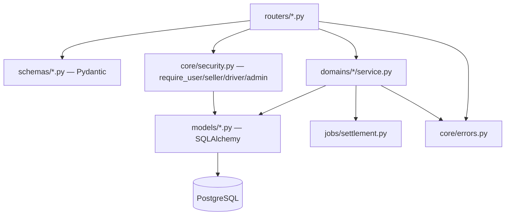

# TARGET_FASTAPI_ARCHITECTURE.md

Phase 02 — Deliverable 3 of 10. All content here is **PROPOSED** unless explicitly marked otherwise (a few citations to existing Next.js patterns being mirrored are VERIFIED, carried from Phase 01 and this phase's own re-verification).

## 1. Modular monolith structure

Mirrors the domain split Phase 01 already found to be a good, proven boundary in the existing `src/server/**` tree (catalog, cart, orders [incl. seller/driver sub-services], seller, security) — this is a direct translation of an already-correct boundary, not a redesign:

```
fastapi_app/
  main.py                      # app factory, middleware, router mounting
  core/
    config.py                  # pydantic-settings: env vars (mirrors .env.example)
    security.py                # session cookie validation, bcrypt, CSRF, OTP crypto
    db.py                      # SQLAlchemy async engine/session factory
    errors.py                  # ApiError equivalent, exception handlers -> {error:{code,message,field?}}
    logging.py                 # structured logging setup
  models/                      # SQLAlchemy ORM models, one module per Prisma model group
    identity.py                # User, Session
    seller.py                  # Seller, SellerPincode, Vehicle, Driver, SellerOffer
    catalog.py                 # Category, Product
    cart.py                    # Cart, CartItem, WishlistItem
    orders.py                  # Order, OrderLine, Address, Coupon, Review
    shipment.py                # Shipment, ShipmentEvent, ShipmentIssue, EscrowEntry
    notification.py            # Notification
  schemas/                     # Pydantic request/response models, one module per domain
    auth.py  catalog.py  cart.py  orders.py  seller.py  driver.py  admin.py
  domains/                     # business logic, one package per domain (mirrors src/server/**)
    identity/
      service.py                # register, authenticate, session create/validate/delete
      deps.py                   # require_user, require_customer, require_seller, require_driver, require_admin
    catalog/service.py
    cart/service.py
    orders/
      service.py                 # checkout/placeOrder/cancel — the highest-risk domain, migrated last
      seller_service.py
      driver_service.py
      lifecycle.py                # refreshOrderStage, restoreReservedStock, refundHeldEscrow equivalents
    seller/
      profile.py  delivery.py  inventory.py
    admin/                      # NET NEW — no Next.js equivalent exists
      service.py
    notifications/              # NET NEW
      service.py
  routers/                      # thin HTTP layer, one module per domain, mounted in main.py
    auth.py  addresses.py  catalog.py  cart.py  checkout.py  orders.py
    driver.py  seller.py  admin.py  health.py
  jobs/
    settlement.py                # review->settled, accept-timeout->missed scheduled task
  alembic/
    env.py  versions/
  tests/
    conftest.py                  # async test client + real-Postgres fixture, mirrors describe.skipIf(!hasDb) pattern
    domains/...                  # one test module per domain, mirrors existing *.test.ts layout
```

## 2. Component selections and why

| Concern | Choice | Why | Alternative considered |
|---|---|---|---|
| Web framework | **FastAPI** | Organizationally confirmed requirement (Deliverable 1) | n/a — given |
| ORM | **SQLAlchemy 2.0, async (asyncpg driver)** | Direct conceptual mapping from the existing 20-model Prisma schema; async matches Next.js's own fully-async service layer, avoiding a sync-vs-async mismatch that would otherwise force connection-pool-blocking workarounds under load | Prisma Client Python (exists, but is a thin wrapper around the Node Prisma engine binary — adds an unusual cross-language runtime dependency for a "pure Python" target, working against the stated organizational-standardization goal) |
| Migrations | **Alembic**, but see Deliverable 5 for the critical ownership-sequencing rule (Prisma remains sole migration authority through the entire incremental migration; Alembic is only introduced as the authority at a final, explicit, separately-decided cutover) | Standard, mature, SQLAlchemy-native | Managing the schema by hand with raw SQL (rejected — loses migration history/reproducibility) |
| Validation | **Pydantic v2** | Direct conceptual replacement for the existing Zod schemas (Deliverable 6 maps every existing schema to its Pydantic equivalent); same "reject unexpected fields" discipline achievable via `model_config = ConfigDict(extra="forbid")`, mirroring every existing `.strict()` Zod schema | n/a |
| Auth | **Custom dependency functions replicating the existing opaque-token + server-side-session-table model exactly** (Deliverable 4) — explicitly NOT a stock "FastAPI + JWT" tutorial pattern | The existing session design was a deliberate, already-correct choice (D21: rejected JWT specifically for lack of revocation) — reusing it is lower-risk than introducing a second auth paradigm | `fastapi-users` or similar packages (rejected: they assume ownership of the user table/auth flow from scratch, which would mean re-registering every existing user — directly violates this phase's "existing users must not be forced to register again" constraint) |
| Background jobs | **A single scheduled script invoked externally** (platform cron / Cloud Scheduler hitting an authenticated internal endpoint, or a lightweight `apscheduler` process if the chosen host doesn't offer native cron) for the one confirmed-missing job (settlement/timeout, Deliverable 7 §G) | Matches Phase 01's own explicit "do not introduce Celery/Redis/queues prematurely" finding — one job, run on a schedule, with no inter-job dependency, does not need queue infrastructure | Celery+Redis (rejected as premature at current scale — reconsider only if multiple, high-volume, retry-heavy jobs materialize) |
| File storage | **Object storage (provider depends on the still-open deployment-target decision), accessed via a signed-URL upload pattern** | Matches Phase 01's own recommendation (`TARGET_SYSTEM_ARCHITECTURE.md §3`); keeps large binary traffic off the application process | Storing files in Postgres as bytea (rejected — wrong tool, bloats backups) |
| Logging/monitoring | **Structured JSON logging (`structlog` or stdlib `logging` with a JSON formatter) + one error-tracking integration (Sentry's Python SDK)** | Directly fixes a confirmed Phase 01 gap (zero structured logging, zero APM anywhere in the current Next.js backend) — the migration is a natural point to introduce this correctly from day one in the new code, rather than carrying the gap forward | n/a |
| Testing | **pytest + pytest-asyncio + httpx.AsyncClient against a real, disposable test Postgres (via a Docker-Compose test service or a dedicated CI Postgres container)** | Directly mirrors the existing, already-proven-sound Vitest pattern (`describe.skipIf(!hasDb)`, real Postgres, not mocks) — same philosophy, different tooling, preserving the project's existing (correct) testing culture rather than introducing a mocked-DB anti-pattern | Mocking the database layer (rejected — the existing test suite's own value comes specifically from testing against real Postgres, catching real constraint/transaction behavior; a migration should not regress this) |

## 3. Why avoid premature microservices (reaffirmed)

Nothing about adopting FastAPI requires, or even suggests, splitting the single backend into multiple deployed services beyond the Next.js-app / FastAPI-app split that is already the explicit target. Phase 01 found current scale to be small (a handful of sellers, tens of seeded orders); this phase's own instruction echoes "avoid premature microservices." The `domains/` package structure above gives clean internal boundaries (each domain's service/schema/router triad is independently testable and, if ever truly necessary, independently extractable later) without paying the operational cost of separate deployments, separate databases, or network calls between domains today.

## 4. Mermaid: internal module dependency direction



This intentionally mirrors the existing Next.js layering exactly (`route.ts` → `requireX()` → service function → Prisma → DTO), which is why Phase 01's finding of zero IDOR defects in that layering is a genuinely reusable asset, not something a framework change puts at risk by default — the risk is entirely in *how faithfully* each piece gets re-implemented (Deliverable 4, 6, 7 address this per-domain).
